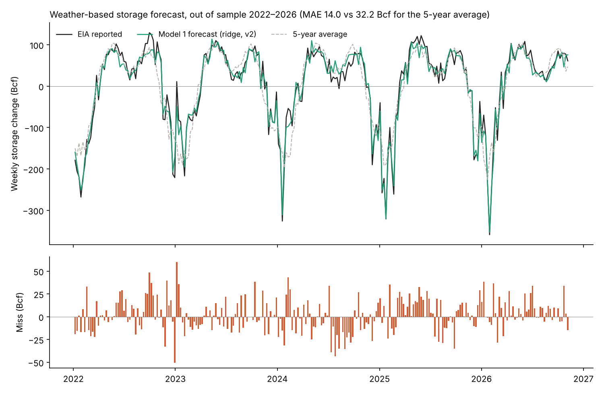

# From weather to the gas curve

How far up the chain **weather → weekly storage → end-of-season storage → futures spread** can free public data forecast US natural gas, out of sample?

The rules are fixed in [`reports/protocol.md`](reports/protocol.md): timing, samples, benchmarks, success criteria, and a change log.

## Status (17 Nov 2026)
- **Model 1, weekly storage change:** done, v3.
  - Out-of-sample mean absolute error is **13.8 Bcf**, against **31.3** for the 5-year average, over 253 weeks from 2022 (own data pulls).
  - The 80% ranges cover 84.6% of outcomes.
  - Ridge beats gradient boosting.
- **Model 2, end-of-season storage scenarios:** v2 done.
  - The 80% ranges are calibrated (they cover 84–90% of outcomes on the 2022+ holdout).
  - Its central forecast beats the 5-year-average path only within about 8 weeks of season end. See the protocol.
- **Model 3, futures spreads:** pending price data.

## Live record
A GitHub Action ([`live_forecast.yml`](.github/workflows/live_forecast.yml)) runs every Wednesday at 12:00 UTC, before EIA's release. It refreshes storage from EIA's bulk file, scores last week's forecast, and commits this week's forecast to [`reports/live_forecasts.csv`](reports/live_forecasts.csv). The bot's commit time is the timestamp.

## Run
```
pip install -r requirements.txt
python -c "from src.fetch import from_bulk; from_bulk('NG.txt')"   # EIA bulk file, no key
python -c "from src.fetch import fetch_weather, weekly_degree_days; weekly_degree_days(fetch_weather())"
python -m src.model1 v2 v3_own
python -m pytest tests            # no-look-ahead checks
```


