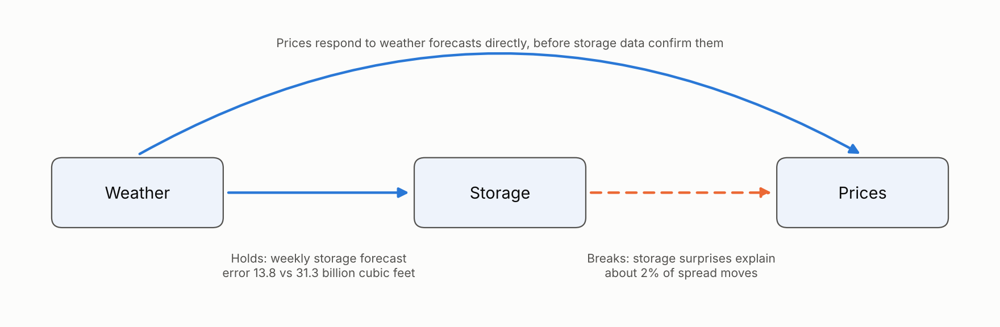
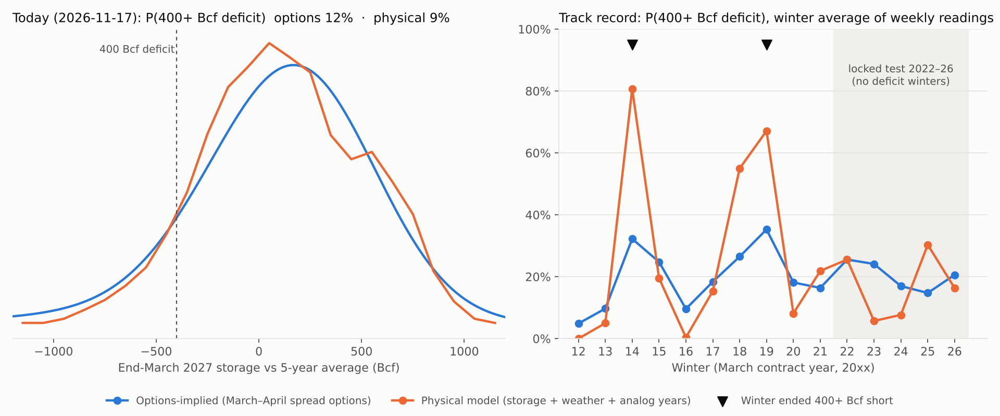
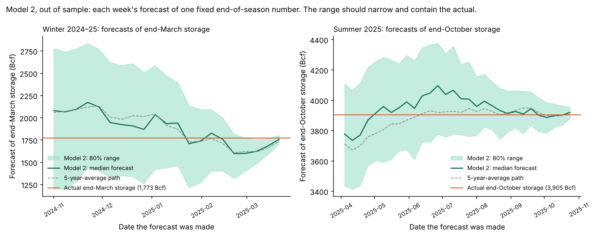

# The winter squeeze premium in US natural gas

*Working paper, November 2026 · [pre-registration log](reports/protocol.md) · [holdout results](reports/holdout/) · [live monitor](reports/monitor/README.md)*

## Abstract

This paper asks whether public information about weather and gas storage can be used to anticipate prices in the US natural gas market. Storage proves to be quite predictable from the weather. Prices, however, respond to the weather well before the storage data confirm its effect, so a storage forecast says little about prices that the market does not already know.

One effect nonetheless survives every test: the market pays a persistent premium for protection against a gas shortage at the end of winter.
- Selling the March–April futures spread in December and holding it to expiry earned money in 21 of 26 winters.
- Options on these spreads were priced for 27% to 39% more price movement than subsequently occurred, and the pattern was confirmed in a holdout period that was tested only once.

To follow this pattern as it develops, a [weekly monitor](reports/monitor/README.md) records the size of the option premium and sets the market's implied odds of a shortage beside those of a physical model of storage and weather.


*Figure 1. Left: the profit or loss from selling one March–April futures spread on 1 December and holding it to expiry, for each winter from 2001 to 2026. Right: the extent to which options on these spreads overstated the spread's subsequent movement, before and after 2022. The vertical lines show 95% confidence intervals.*

## 1. The question

Natural gas is stored through the summer and withdrawn through the winter, so the amount left in storage at the end of March summarises how demanding the winter has been. Weather drives demand, demand drives withdrawals from storage, and the expected level of storage should in turn be reflected in futures prices.

Each link in this chain can be measured with public data. The aim of the project was to find how far along the chain a forecast remains useful. A forecast of the weather may well predict storage, but whether a forecast of storage predicts prices is a separate question. If it does, the chain yields a trading signal. If it does not, the point at which it breaks says something about how the market works.

## 2. Approach

The project built one model for each link of the chain and one test for each claim. Their construction is described in full in [Appendix A](#appendix-a-methodology).
- **Storage.** A regression predicts the weekly change in storage from temperatures, and a simulation extends it to the end of the season.
- **Prices.** A set of tests asks whether storage, or deviations from expected storage, explain or predict the March–April price spread.
- **The premium.** Two measurements, one in futures and one in options, ask whether the market overpays for protection.

Every test followed the same procedure, designed to prevent the results from being shaped after the fact.

1. **Each hypothesis was written down before any results were seen**, together with the rule for judging whether it had succeeded. These records, and the exact code used, are committed to this repository with timestamps.
2. **The models were developed on data from 2010 to 2021.** The years 2022 to 2026 were withheld and used for a single final test. The futures results were also tested once on the earlier decade, 2000 to 2010.
3. **Uncertainty was measured winter by winter.** Daily observations within one winter are closely related, and treating them as independent would overstate the strength of the evidence.
4. **Every final result is published, whether or not it supported the hypothesis.**

The weather and storage data are public and come from the US Energy Information Administration and the US weather service. The futures and options prices are exchange data purchased from a data vendor. Because those prices are licensed, the repository contains the code and the results derived from them but not the prices themselves.

## 3. Where the chain holds and where it breaks


*Figure 2. The chain from weather to prices. The link from weather to storage holds; the link from storage to prices does not, because prices respond to weather forecasts directly.*

The physical link of the chain holds well.
- **Weekly changes.** A regression predicts each week's change in US gas storage from temperatures, weighted by where gas is consumed. Over 253 weeks that the model had not seen, its average error was 13.8 billion cubic feet, compared with 31.3 for the conventional benchmark, the five-year average.
- **End of season.** To forecast storage at the end of the season, the model is run forward through the weather of about twenty past winters, which produces a range of possible outcomes. Ranges intended to contain the true outcome 80% of the time contained it 85% to 93% of the time in the final test. The model's statement of its own uncertainty was therefore reliable, and if anything slightly cautious.
- **Live record.** Since 18 November 2026 the model has published a forecast every week, before each official storage report. These forecasts are recorded in the [live forecast log](reports/live_forecasts.csv).

The link from storage to prices does not hold in any way that can be exploited.
- **Surprises.** Storage reports that differ from normal explain about 2% of the weekly movement in the March–April price spread.
- **Timing.** Prices respond to weather forecasts as soon as those forecasts are issued, often a week or more before the storage report confirms their effect. By the time storage is known, the information is already in the price.
- **Trading rules.** Consistent with this, none of the trading rules built on storage survived the final test. A rule that bet on the reversal of unexplained price moves worked from 2010 to 2021 but failed in the earlier decade.
- **Options.** Option prices did not predict the direction of futures prices either.

What remained after these tests was not a way of forecasting prices but a regularity in how the market prices risk. That regularity is the subject of the next section.

## 4. What survives: a premium for protection against a shortage

March is the last month of the heating season. If storage runs short, the price of March gas can rise far above the price of April gas, and anyone committed to delivering gas in March can suffer large losses. Such participants have good reason to pay for protection against this outcome. If they consistently pay more than the protection is worth, those who sell it should earn small profits in most winters and suffer occasional severe losses. The evidence shows exactly this pattern, in two separate markets.

**The futures market.**
- *Result.* Selling one March–April futures spread on the first trading day of December and holding it to expiry earned money in 21 of the 26 winters from 2001 to 2026. The typical (median) gain was about $1,200 per contract and the average about $1,800.
- *The losses.* These reveal the nature of the trade. In 2003 a late-winter shortage cost $28,400 per contract, roughly sixteen average winters of gains.
- *The earlier decade.* The pattern also held from 2000 to 2010, a decade examined only in the final test.

**The options market.**
- *Why options should show the premium.* An option on the spread pays its holder when the spread moves far from its current level. A call option pays when March rises well above April, which is the shortage itself, so buying one is a direct way of buying protection. The fair price of such an option depends on how far the spread can be expected to move: the larger the expected movement, the more the option is worth. It follows that if buyers pay more than the protection is worth, option prices will be higher than the spread's actual movement justifies. Equivalently, when the price is translated back into an expected movement, it implies more movement than occurs.
- *The test.* The movement implied by each option's price was compared with the movement the spread actually showed before the option expired.
- *Development period.* Between 2010 and 2021, options implied 39% more movement than occurred.
- *Withheld period.* For the years 2022 to 2026, the test was fixed in advance and run once. Options implied 27% more movement than occurred, with a 95% confidence interval of 7% to 52%. The result held through the 2022 energy crisis.

**Collecting the premium.** Whether it can be collected after trading costs has not been established. A strategy that sold these options was profitable in the final test, but not by a margin large enough to rule out chance, and it lost money in the earlier period.

## 5. A monitor of the premium

That the premium cannot yet be shown to be collectable does not make it uninformative. Its size is the price of protection against a late-winter shortage, and that price is of direct concern to anyone holding winter gas exposure, whether they buy protection or sell it.

The comparison between prices and fundamentals also separates two things that a single price conflates.
- The first is how likely a shortage is.
- The second is how much the market fears it.

When option prices imply a shortage that the physical evidence does not support, the difference is a measure of that fear. Finally, the open questions in section 6 cannot be answered without a record of how the premium varies from week to week. The monitor exists to build that record.


*Figure 3. Left: the distribution of end-March 2027 storage relative to its five-year average, as implied by option prices (blue) and by a physical model of storage and weather (orange), on 17 November 2026. Right: each model's probability of a shortfall of 400 billion cubic feet or more, averaged over each winter.*

The monitor takes two readings each week from November to mid-February. Each is recorded in the [monitor log](reports/monitor/README.md).

**First, it compares the movement implied by current option prices with the movement the spread is actually showing.**
- On 17 November 2026, the options implied movement of about 47 cents a year, while over the previous four weeks the spread had moved at about 10 cents a year.
- At the same point in past winters, the options overstated the spread's subsequent movement in 10 of 13 cases, typically by a factor of two.

**Second, it translates option prices into the probability the market assigns to a storage shortfall, and sets this beside the probability given by the physical model.**
- On 17 November 2026, the options implied a 12% chance that end-March storage would fall 400 billion cubic feet or more below its five-year average. The physical model gave 9%.
- This second measure was tested before use, and it failed. From 2022 to 2026 no such shortfall occurred, yet the options assigned it a probability of 15% to 25% every year. A simple historical average therefore proved more accurate.
- The failure is consistent with a premium, since the market once again paid for protection it did not need. Five uneventful winters, however, cannot distinguish a premium from a lack of skill.
- The monitor therefore reports what the market is pricing, and makes no claim about where storage will end up.

## 6. Conclusion

The chain from weather to prices holds in its physical link and breaks where prices enter. Storage can be forecast, but prices have already responded to the weather that drives it. What survives is not a means of predicting prices but a regularity in how the market prices risk. Buyers of protection against a late-winter shortage pay more than the protection turns out to be worth, in futures and in options alike, and the sellers of that protection are occasionally exposed to severe losses.

Three questions remain open:
- whether the premium can be collected after costs;
- whether its size changes predictably with storage and weather;
- whether a physical estimate of fair value can indicate when the premium is largest.

The monitor and the live forecast record are designed to answer these questions as new winters arrive.

## Appendix A: Methodology

<details>
<summary>How each model was built and how each figure in the paper was estimated</summary>

**A.1 Data.**
- *Storage.*
  - Weekly and monthly US working gas in storage from the US Energy Information Administration (EIA).
- *Weather.*
  - Daily temperatures for 17 cities, weighted by each region's gas consumption.
  - Archived ensemble forecasts from the US weather service (GEFS), and its 6–10 and 8–14 day outlooks.
- *Prices.*
  - Daily settlement prices of NYMEX natural gas futures, and of options on those futures and on the spreads between adjacent months, from 2010.
  - EIA's published futures prices for the years before 2010.

**A.2 Weekly storage model (section 3, Figure 2).**
- *Target.* The weekly change in storage.
- *Inputs.*
  - Heating and cooling degree days, together with their deviations from normal and their squares.
  - Seasonal terms and the five-year average change.
  - The previous weeks' forecast errors and a holiday indicator.
- *Fitting.*
  - The model is a ridge regression, a linear regression whose coefficients are shrunk towards zero to limit overfitting.
  - The strength of that shrinkage (0.1) was chosen by forecast error on 2018–2021, from a grid between 0.001 and 100.
  - The model is refit every week using only data available at the time.
- *Accuracy.* Measured as mean absolute error over January 2022 to November 2026, against the five-year average change. The confidence interval for the improvement comes from resampling blocks of eight consecutive weeks, because errors in neighbouring weeks are related.
- *Alternative model.* A gradient-boosting model (learning rate 0.03, 7 leaves, 300 iterations, minimum leaf size 20, L2 penalty 1.0, refit every four weeks) scored 14.6. It was not significantly different (difference 0.9, interval −0.9 to 2.8), so the simpler model is used.

**A.3 End-of-season ranges (section 3).**
- *Simulation.* From each forecast date, the weekly model is run to the end of the season once for each of about twenty historical weather years.
- *Weather years.* Each year is adjusted to the latest ten-year normal temperature.
- *Error paths.* The model's own out-of-sample errors are added back, drawn in four-week blocks from the same half of the year.
- *Calibration.* The 80% range is the 10th to 90th percentile of the simulated outcomes. Calibration is the share of forecasts whose range contained the outcome.
- *Limit.* This is a distribution of historical weather scenarios, not a probabilistic weather forecast.

**A.4 Storage and prices (section 3).**
- *The "2%" figure.* This is the R² from regressing the weekly change in the March–April spread on the storage surprise, defined as the reported change minus the five-year average change, from January 2022 to February 2026.
- *The trading rules tested.*
  - Curve shape.
  - Implied versus forecast storage.
  - A storage-based fair value.
  - The reversal of price moves not explained by weather-forecast revisions.
- All are specified, with their pass/fail rules, in the [pre-registration log](reports/protocol.md). Their results are in [`reports/holdout/`](reports/holdout/).

**A.5 Futures premium (section 4, Figure 1 left).**
- *Trade.* For each winter from 2001 to 2026, the March–April spread is sold at the settlement price on the first trading day of December. It is valued at the March option expiry.
- *Profit.* The entry spread minus the exit spread, multiplied by 10,000 MMBtu.
- *Costs.* None are deducted. A round trip costs roughly $100–200 per spread, small relative to the median gain.

**A.6 Options premium (section 4, Figure 1 right).**
- *Sample.* For each trading day and each spread option with open positions and between 5 and 126 trading days to expiry, the at-the-money price is converted into an implied movement, using the standard model for options on spreads (the Bachelier model).
- *Comparison.* That implied movement is compared with the movement the spread actually showed from that day until the option expired: the annualised root mean square of its daily changes.
- *Statistic.* The average logarithm of the ratio, so that a value of 0.24 corresponds to options implying about 27% more movement than occurred.
- *Confidence interval.* Obtained by resampling whole winters 5,000 times.
- *Freezing.* The test code was fixed and recorded by its hash before the withheld years were opened ([summary](reports/holdout/SUMMARY_v5.md)).

**A.7 Monitor (section 5, Figure 3).**
- *Movement comparison.* Today's implied movement of the March–April option is compared with the spread's movement over the past 20 trading days. The historical comparison uses the readings nearest 17 November in each past winter.
- *Shortage odds.*
  1. Option prices at every strike are converted into a full probability distribution for the spread at expiry. The rate at which the option price changes with the strike gives the probability of each outcome.
  2. That distribution is mapped to end-March storage, using the historical relation between the spread at expiry and storage relative to its five-year average. The map is fitted only on winters before the one being assessed.
- *Physical model.* It starts from the latest storage report, adds the weather observed since, then the weather service's 15-day forecast, and then the weather of comparable past winters.
- *Pre-registered test.* Scored by the Brier score, the average squared difference between forecast probabilities and outcomes, against the historical frequency ([test](reports/tool/GATE.md), [result](reports/tool/GATE_RESULT.md), [notes](reports/tool/integration.md)).
</details>

## Appendix B: Repository and reproduction

<details>
<summary>Repository map and commands</summary>

| Path | Contents |
| --- | --- |
| `src/model1.py`, `src/model2.py`, `src/live.py` | Weekly model, end-of-season ranges, live job |
| `src/collect/` | Data collection, run by GitHub Actions |
| `src/v4/`, `src/v5/` | Weather-forecast and options studies |
| `src/tool/` | Monitor, final test, figures |
| `reports/monitor/` | Monitor log |
| `tests/` | Checks that no forecast uses future data |

```
pip install -r requirements.txt
python -m pytest tests
python -m src.model1
python -m src.model2
```



</details>
