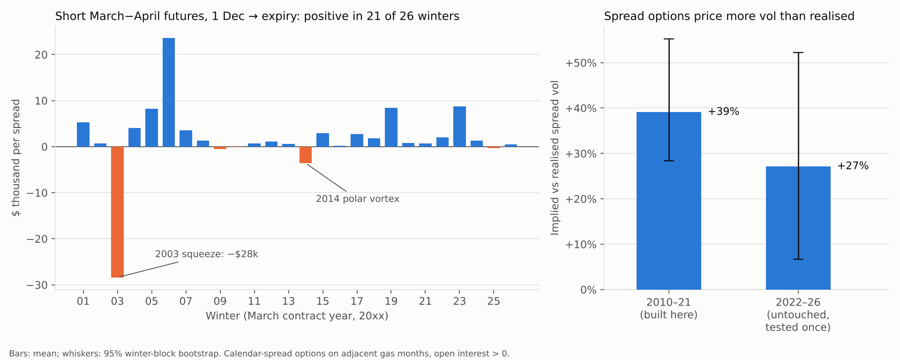

# From weather to the gas curve

**Where does weather and storage information show up in US natural gas futures and options, and where doesn't it?**

Every test was written down and pushed here *before* its results were seen. The last years of data were held back and tested once. Failures are published alongside successes.



## Three results

| | Result | Evidence |
| --- | --- | --- |
| **1. Futures** | Traders overpay for end-of-winter squeeze insurance. Shorting March−April futures from 1 December to expiry paid in **21 of 26 winters** (2001–26). | Rare, large losses (2003: −$28k per spread). That is the shape of an insurance premium, not a free lunch. [v4 summary](reports/holdout/SUMMARY_v4.md) |
| **2. Options** | The same premium appears in options. Calendar-spread options on adjacent gas months price **27–39% more spread volatility than is realised**. | 2010–21: +39%. Then on untouched 2022–26 data, tested once: **+27%, 95% CI +7% to +52%**. [v5 summary](reports/holdout/SUMMARY_v5.md) |
| **3. Physical** | A weekly storage forecast misses by **13.8 Bcf**, against 31.3 Bcf for the 5-year average (−56%). | Out of sample, 253 weeks from 2022. 95% CI on the improvement: 11–24 Bcf. Runs live every Wednesday before EIA's report. |

## Live: Winter Squeeze-Risk Monitor


Every week from November to mid-February, the monitor shows what the options are pricing for the end of winter, next to what the fundamentals say.

**Reading for winter 2026-27 (options as of 17–19 Nov 2026):**
- **Spread-option richness: the premium.**
  - March−April options imply a spread volatility of **$0.47** per year.
  - The spread has actually moved at **$0.10** over the last 20 days.
  - In past winters, mid-November implied volatility exceeded what the spread then realised in **10 of 13** cases, typically by about 2×.
- **Scarcity odds.**
  - Options imply a **12%** chance that end-March storage finishes 400+ Bcf below its 5-year average.
  - The physical model (storage, weather forecasts, past-winter analogs) says **9%**.
  - Options price a **3%** chance of a 25¢+ March−April squeeze.

**How far to trust it:** the scarcity odds were tested before use ([frozen test](reports/tool/GATE.md), [result](reports/tool/GATE_RESULT.md)) and **lost to the historical average on 2022–26**. No deficit winter occurred, yet the options priced 15–25% odds every year. That matches the premium above, but five quiet winters can't prove it. So the monitor reads the market; it does not forecast storage.

## What did not work

- **Storage surprises barely move the March−April spread** (holdout R² 0.02). The curve moves on weather forecasts, ahead of the storage reports.
- **No relative-value trading rule survived its holdout.** This covers curve kinks, implied vs forecast storage, storage-based fair value and premium-shock reversal (it worked in 2010–21 and reversed in 2000–10).
- **Option prices and Greeks don't forecast the futures.** Outright option volatility is roughly fair.
- **Harvesting the options premium after costs is not proven.** The short spread-option straddle was +$176 per trade on 2022–26, but its interval includes zero, and it was negative in development.
- **The storage-centre forecast** beats "normal" only within about 8 weeks of season end. Earlier, weather is unforecastable.

## How the work is tested

1. **Write the test first.** Hypotheses, thresholds and pass/fail rules are committed before any result is seen. The log is in [`reports/protocol.md`](reports/protocol.md), including weaker model versions.
2. **Hold data back.**
   - Build on 2010–21.
   - Test once on 2022–26, and separately on 2000–10.
   - The frozen code's sha256 hashes are recorded.
3. **Publish everything.** Every holdout result is in [`reports/holdout/`](reports/holdout/), passes and fails alike.
4. **Run live.** GitHub Actions record forecasts weekly, before the outcome is known; the commit time is the timestamp.

<details>
<summary><b>Model details</b> (storage forecast, scenario model, specifications)</summary>

**Model 1: this week's storage change from this week's weather.**
- Ridge regression on gas-weighted heating and cooling degree days, their anomalies and squares, seasonality terms, the 5-year average change, recent forecast errors, and a holiday flag.
- Settings:
  - ridge alpha = 0.1, chosen by validation MAE on 2018–21 from {0.001 … 100};
  - refit weekly;
  - holdout 2022–26 (253 weeks).
- Results:
  - 13.8 Bcf mean absolute error, vs 31.3 for the 5-year average;
  - 80% ranges contained the outcome 85% of the time.
- Gradient boosting (HistGradientBoosting: learning rate 0.03, 7 leaves, 300 iterations, min leaf 20, L2 1.0; refit every 4 weeks) scores 14.6 Bcf.
- The two are statistically tied (difference 0.9 Bcf, CI −0.9 to 2.8), so the simpler model is used.
- Model 2 and the live forecast use the same alpha and features.

**Model 2: end-of-season storage as a probability range.**
- Model 1 is simulated forward through about 20 historical weather years, each re-centred on the latest 10-year normal, plus out-of-sample errors resampled in 4-week blocks from the same half of the year.
- This is an empirical scenario distribution, not a weather-probability forecast: analog years are not weighted by forecast regime.
- The 80% ranges covered the outcome 85–93% of the time from 2022.
- Later studies (v4) added archived GEFS ensemble forecasts.

**Monitor components** ([integration notes](reports/tool/integration.md)):
- a risk-neutral density of the March−April spread from spread-option settles;
- a walk-forward spread → storage map (winters since 1994);
- a physical analog model;
- spread-option richness.


</details>

<details>
<summary><b>Data, repository map, reproduce</b></summary>

**Data:**
- Public: EIA storage and futures, Open-Meteo, NOAA GEFS reforecasts and CPC outlooks.
- Licensed: CME futures and options settlements via Databento. These are not redistributed; scripts and derived results only.

| Path | What it is |
| --- | --- |
| `src/model1.py`, `src/model2.py`, `src/live.py` | Storage forecast, scenario model, weekly live job |
| `src/collect/` | Data collectors (GEFS, CPC, EIA), run by GitHub Actions |
| `src/v4/`, `src/v5/` | Weather-news study, options study |
| `src/tool/` | Squeeze-Risk Monitor: densities, storage map, physical model, gate test |
| `reports/protocol.md` | Pre-registration and change log |
| `reports/holdout/` | Every holdout result |
| `reports/live_*.csv`, `reports/live_2026_27/` | Live records and frozen live protocol |
| `tests/` | Checks that no forecast sees future data |

```
pip install -r requirements.txt
python -m pytest tests          # no-look-ahead checks
python -m src.model1            # Model 1 walk-forward
python -m src.model2            # Model 2 backtest
```
</details>
