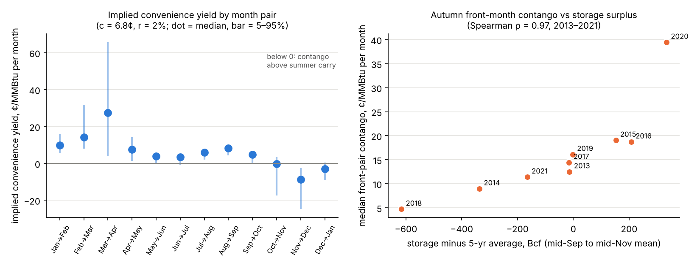
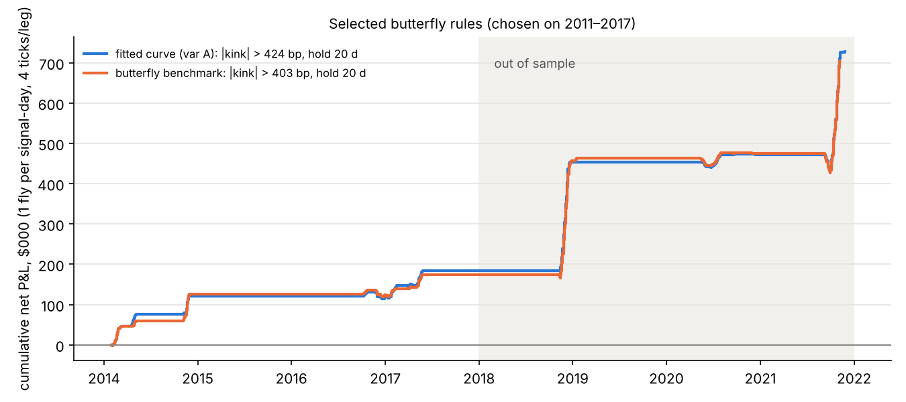
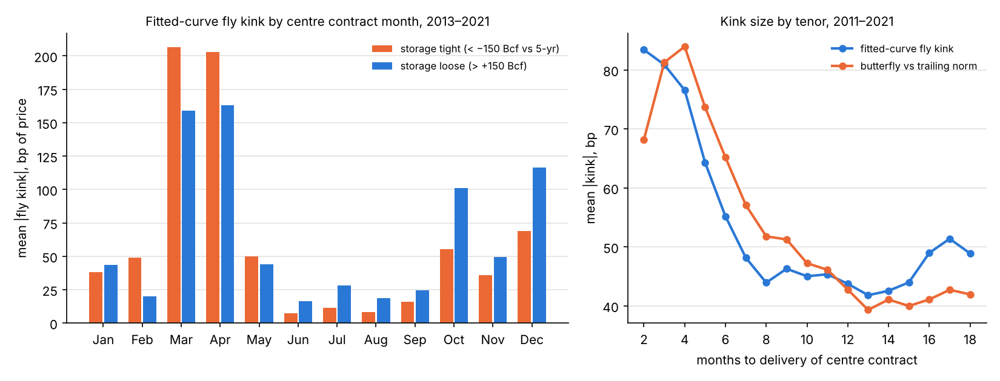

# Q1: Internal consistency of the Henry Hub curve (agent `curve_consistency`)

*Data: CME settles 2010-06-04 to 2021-12-31 and EIA storage before 2022 only. No 2022+ row was loaded. Design choices were made on 2011–2017, and 2018–2021 is the check.*

## 1. Plain-English findings
- **The summer carry bound is not violated in any useful way.** Within the injection season, month-to-month contango tops out at about **7¢/MMBtu per month** (95th percentile). Larger contango appears almost only in the **Oct→Nov, Nov→Dec and Dec→Jan** pairs. There it measures how full storage is, not a riskless arbitrage: across years, autumn front-month contango has a rank correlation of **ρ = 0.97** with the storage surplus against the 5-year average. It ranged from 4.7¢ in 2018 (−616 Bcf) to 39.5¢ in 2020 (+334 Bcf).
- **Most kinks are real information, not errors.** Fitted-curve kinks are very persistent. Only about **12% (2011–17) to 30% (2018–21)** of a kink closes within 20 trading days. A typical kink (about 90 bp) is worth about $60 per butterfly in expected 20-day reversion. The round-trip cost at 4 ticks is $160. **Small and medium kinks lose money after costs**, in every variant and in both periods.
- **Large kinks sit almost entirely at the March−April step.** 77% of the largest 5% of kinks are on March- or April-centred butterflies. They are bigger when storage is tight: March looks rich and April cheap by about **±165 bp** against the smooth curve, compared with ±45 bp when storage is normal.
- **The only rule that made money is "fade extreme Mar/Apr kinks for 20 days".** Out of sample it earned **+$2,166 per butterfly at 4 ticks, but the 95% CI is −$313 to +$3,616**. That comes from only 5 independent episodes, 2 of which supply nearly all the profit: Nov–Dec 2018 and Oct–Nov 2021. In economic terms it is selling the winter-scarcity premium, with real tail risk. This is not a free consistency arbitrage.
- **The simplest benchmark is as good as the fitted curve.** A butterfly measured against its own trailing seasonal norm has a correlation of 0.92 with the fitted-curve signal. It predicts 20-day kink changes slightly better out of sample (R² 9.5% vs 7.4%), and its trade results are statistically indistinguishable.

## 2. Method
**Carry and convenience yield.** For every day and every pair of adjacent listed months among the first 18 contracts, the spread is s = F_far − F_near ($/MMBtu per month). The implied convenience yield is y = c + r·F_near/12 − s, with r = 2% and 5%. I estimated c in three ways, all on 2011–2017:
- (i) the brief's suggestion: the 95th percentile of front-pair contango from mid-September to mid-November, when storage is near full. This gives **c = 30.0¢** (median 15.5¢, maximum 35¢).
- (ii) the same quantity walk-forward, using only prior autumns: 32–40¢.
- (iii) the 95th percentile of within-injection pairs (Apr→May through Aug→Sep, any tenor): **c = 6.8¢**.

Financing adds only 0.5–1.25¢ per month at $3 gas, so the choice between r = 2% and 5% changes no conclusion.

**Fair curve.** Each trading day, the model is log F(m) = a + b·x + c·x² + λ·S[calendar month of m], with x = months to delivery / 12. It uses positions 1–18 and drops any contract with 5 or fewer trading days left. The 12-number seasonal shape S is re-estimated each 1 January from the previous 3 years only, by alternating least squares. In variant A, λ = 1. In variant B, λ is free each day. The kink is the residual. The tradable form is the **fly kink**: r(m) − ½[r(m−1) + r(m+1)].

**Benchmark.** The log butterfly is L = log F(m) − ½[log F(m−1) + log F(m+1)]. Its benchmark kink is L minus the mean of L for the same (centre calendar month, months-to-delivery) cell over the previous 3 calendar years.

**Reversion.** I ran a pooled OLS of Δkink(t → t+h) on kink(t) for the same contract, with h = 1, 5 and 20 trading days. CIs come from a bootstrap that resamples calendar months (2,000 draws).

**Trade.** On each signal day, for each centre contract with |fly kink| above the threshold, I trade one 1:−2:1 butterfly (4 contracts), short the centre if it is rich, and exit at the settle 20 trading days later. A trade is dropped if any leg would be within 5 trading days of expiry at exit. P&L is −sign(kink) × 2 × ΔB × 10,000 per butterfly, where B is the dollar butterfly. Cost is 4 contracts × ticks × $10.

The grid had 3 signals (fA, fB, benchmark) × 5 thresholds (2011–17 quantiles of 50, 75, 90, 95 and 99%) × 3 holding periods (1, 5, 20 days), which is **45 variants**. The winner was picked by 2011–17 t-statistic at 4 ticks. CIs come from a 3-month moving-block bootstrap of monthly P&L sums.

**Storage condition.** This is the latest *public* EIA level (week ending F counts from Thursday F+6) minus its calendar-aligned 5-year average, using at least 3 prior years, so it is available from 2013.

## 3. Results
**Carry exceedances** (r = 2%; at r = 5% the share moves by at most 0.15 pp):

| c used | Period | % of pair-days with contango > carry | Mean / max excess (¢) | Where |
|---|---|---|---|---|
| Autumn q95, 30¢ (fixed) | 2011–17 | 0.29% (4.9% of days) | 3.0 / 18 | Oct→Nov, Nov→Dec |
| | 2018–21 | 1.22% (13% of days) | 10.8 / 57 | 2020: 4.9% of pair-days |
| Autumn q95 (walk-forward) | 2011–17 / 2018–21 | 0.01% / 1.06% | 6.4 / 10.5 | same |
| Summer pairs q95, 6.8¢ | 2011–17 / 2018–21 | 23% / 20% | 6.5 / 6.6 | Oct→Nov 52%, Nov→Dec 99%, Dec→Jan 93%; other pairs ≤7% |

The implied convenience yield is highest for Mar→Apr: median 27.5¢ per month, 5–95% range 4–66¢ (Fig. 1, left). The autumn contango against storage surplus is shown in Fig. 1, right.

**Kink reversion.** Slope β of Δkink on kink, with 95% CIs from the month-cluster bootstrap. β = −1 would mean full correction.

| Signal | h | 2011–17 β | 2018–21 β | OOS R² (2011–17 slope) |
|---|---|---|---|---|
| Fly kink, fitted A | 1 | −0.007 (−0.011, −0.004) | −0.017 (−0.031, −0.001) | 0.5% |
| | 5 | −0.036 (−0.057, −0.015) | −0.064 (−0.127, +0.001) | 2.0% |
| | 20 | −0.115 (−0.191, −0.038) | −0.304 (−0.520, −0.013) | 7.4% |
| Fly benchmark | 1 | −0.008 (−0.012, −0.005) | −0.019 (−0.028, −0.004) | 0.6% |
| | 5 | −0.044 (−0.068, −0.020) | −0.073 (−0.138, −0.011) | 2.8% |
| | 20 | −0.141 (−0.235, −0.042) | −0.309 (−0.468, −0.056) | 9.5% |
| Contract kink, A | 20 | −0.184 (−0.247, −0.120) | −0.269 (−0.427, −0.083) | n/a |

Variant B (λ free) is within the CIs of A everywhere. Fly kinks have a standard deviation of 88 bp (2011–17) and 128 bp (2018–21).

**Trades.** All three signals chose the same setting on 2011–17: the 99th-percentile threshold and a 20-day hold. For fA the threshold is **424 bp**. Every lower threshold and every 1- or 5-day hold loses money at 4 ticks in both periods. At the median threshold the loss is −$110 to −$158 per butterfly.

| Rule (4 ticks per leg unless stated) | Period | Trades / months | $ per butterfly (95% CI) |
|---|---|---|---|
| fA > 424 bp, hold 20 days | 2011–17 | 272 / 14 | +677 (+197, +1,552) |
| | 2018–21 | 251 / 11 | **+2,166 (−313, +3,616)** |
| same, 10 ticks | 2018–21 | 251 / 11 | +1,926 (−580, +3,272) |
| same, entered at t+1 settle | 2018–21 | 249 / 11 | +2,121 (−352, +3,388) |
| same, excluding Mar/Apr centres | 2011–17 / 2018–21 | 0 / 92 trades | n/a / +206 (+61, +698) |
| same, excluding the 2 best OOS episodes | 2018–21 | | +164 |
| Benchmark > 403 bp, hold 20 days | 2011–17 / 2018–21 | 228 / 265 trades | +766 (+148, +2,063) / +1,999 (−534, +3,301) |
| fA, liquid legs only (volume ≥ 1k and OI ≥ 10k on every leg) | 2016–17 | 133 (of 178) | +467 (+202, +540), vs +356 (−2, +506) for all |
| | 2018–21 | 247 (of 251) | +2,179, essentially unchanged |
| fA > 50th percentile, hold 20 days, liquid legs | 2016–17 / 2018–21 | 2,898 / 6,817 trades | −90 / −109 |

At the **episode level** (signal days grouped when gaps are over 20 trading days), 10 of 11 episodes were positive: 6 of 6 in 2011–17 and 4 of 5 in 2018–21. Entries in September 2021 lost about $1,400 per butterfly before the reversal (Fig. 3).

**Where kinks concentrate** (Fig. 2):
- **By contract month.** Mean |fly kink| is 147 bp for March and 150 bp for April centres, against 10–20 bp for June–September. October (63 bp) and December (70 bp) come next. Of the top-5% kinks, 39% are March-centred, 38% April, 10% December and 8% October.
- **By storage state** (2013–21).
  - Overall |fly kink| averages 61 bp when tight (< −150 Bcf against the 5-year average), 46 bp when normal and 65 bp when loose (> +150 Bcf).
  - **March/April** kinks are largest when tight: 207/203 bp. They lean the same way in all three states (March rich, April cheap), but the tilt is +169/−161 bp when tight against +49/−38 bp when normal and +73/−36 bp when loose.
  - **October/December** kinks are largest when storage is loose: 101/117 bp, against 55/69 bp when tight. This is the capacity effect.
- **By tenor.** Kinks are largest at 2–4 months to delivery (about 80 bp) and fall to about 43 bp beyond 12 months.

## 4. What this tells us
**(a) The futures curve.** Away from the winter edges, a 3-parameter trend plus a fixed seasonal shape fits each contract to within about 1.5% (2011–17) to 2.3% (2018–21) in log terms (residual sd). Deviations decay slowly and are smaller than costs. In that sense the curve is internally consistent. The inconsistencies a smooth model sees are concentrated where physics says the curve *should* be able to kink:
- **The March−April step.** Backwardation has no bound here, and the size of the step is a direct bet on end-of-winter scarcity.
- **The autumn contango into November and December.** Here the binding constraint is storage capacity, so the contango is the rent on scarce storage space, and it rises with fullness.

These kinks are state-dependent, not noise. The partial reversion of extreme March/April kinks looks like a scarcity premium that is paid and then released when winter risk resolves.

**(b) Storage expectations.** Two curve features are clean readings of storage:
- **Autumn front contango** tracks the storage surplus (ρ = 0.97 over 9 years).
- **The March/April kink and spread** widen sharply when storage is tight.

For Q2 and Q3, these are the natural "market-implied scarcity" observables. The rest of the curve adds little.

## 5. Caveats
- **Variants.** 45 trade variants, 2 fitted-curve variants, 3 definitions of c × 2 financing rates, and 3 regression horizons × 5 signals. The selected rule was the top-t setting among 45, so its 2011–17 statistics are optimistic.
- **Few episodes.** The out-of-sample "edge" rests on 5 episodes, and 2 of them supply most of the P&L. Positions overlap (one butterfly per signal day per centre, often 20–40 butterflies open at once), so P&L per butterfly overstates capacity and understates risk.
- **Settlement prices.** I assume execution at the settle. Deferred-month settles are partly derived by CME from spread trades, which may smooth or create kinks at far tenors.
- **Mechanical effects in the regressions.** Settlement noise pushes β toward −1, and annual refits of the seasonal shape add small mechanical changes at year-end.
- **c is endogenous.** The c fitted from autumn data is the rent on capacity, not a physical storage cost, so the "bound" depends on the storage state (2020 broke the 2011–17 level by up to 57¢).
- **Short storage history.** Storage conditioning starts in 2013 because the storage file begins in 2010.
- **Volume and open interest** exist only from November 2015, so the liquidity comparison covers 2016–2021 only.

## 6. Proposed holdout test (frozen)
- **Inputs.** CME settles from 2022-01-03 onward, positions 1–18, excluding contracts with 5 or fewer trading days to expiry. On each 1 January, re-estimate the seasonal shape S from the previous 3 calendar years (2022 uses 2019–2021). Use variant A (λ = 1) with a daily quadratic in months to delivery, exactly as in `kinks.py`.
- **Signal.** Fly kink fA = r(m) − ½[r(m−1) + r(m+1)], with both adjacent months listed.
- **Entry.** Trade when |fA| > **0.04240** (424 bp, the frozen 2011–17 99th percentile). Short the centre (sell 2, buy 1 of each wing) if fA > 0, and the reverse if fA < 0. One butterfly per centre per signal day, entered at the settle of day t.
- **Horizon.** Exit at the settle 20 trading days later. Drop the trade if any leg has 5 or fewer trading days to expiry at exit.
- **Statistic.** Mean net $ per butterfly at **4 ticks per leg** ($160 round trip per butterfly). Report 2, 6 and 10 ticks and a 3-month block-bootstrap 95% CI. Count episodes (signal days separated by more than 20 trading days).
- **Pass/fail.** **Pass** requires mean net > $0 **and** at least 60% of episodes with positive mean net. **Fail** otherwise. With fewer than 3 episodes the result is **inconclusive**. A CI excluding zero is reported but not required, given the 2018–21 CI.

## 7. How to rerun
`python -m src.research.curve_consistency.run_all` from the repo root. It takes about 15 seconds on 1 CPU. Tables are written as CSV to `data/processed/research_curve_consistency/`, and figures to `reports/agents/figures/curve_consistency_*.png`. Code is in `src/research/curve_consistency/`: `data.py`, `carry.py`, `kinks.py`, `reversion.py` and `run_all.py`.
