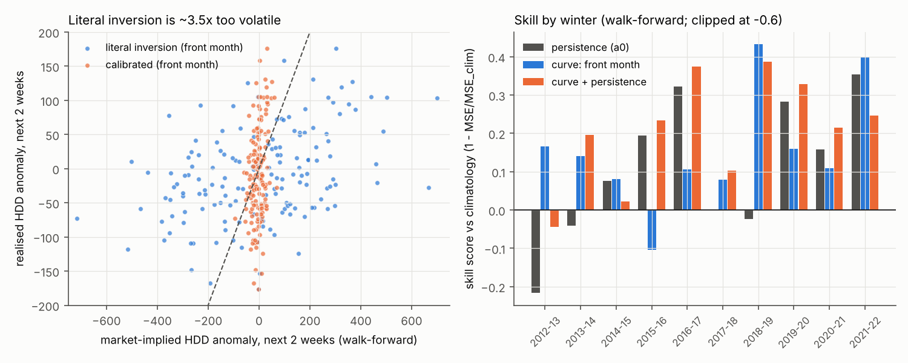
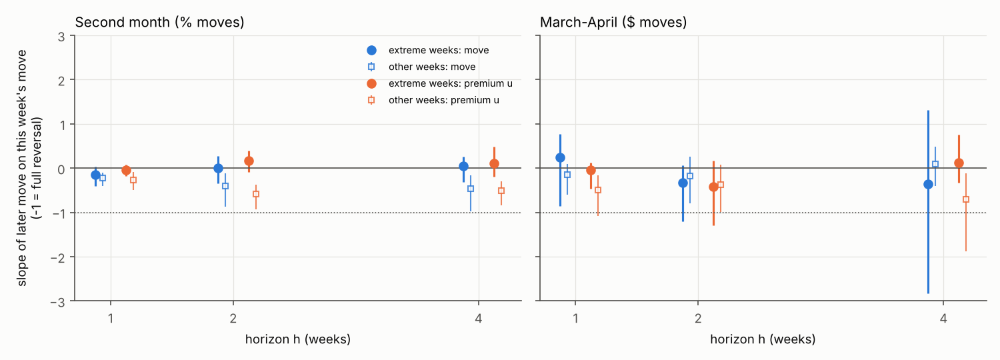
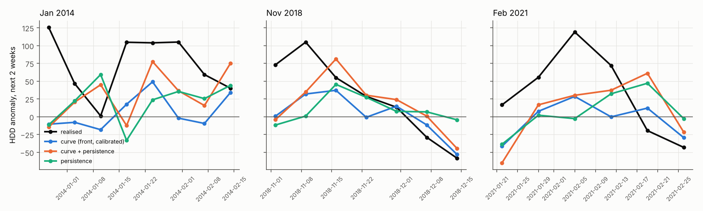

# curve_weather: the futures curve as a 2-week weather forecaster (v3 idea 5)

*Agent `curve_weather`, 22 Nov 2026. Data ≤ 2021-12-31 only, cut on load. Weekly Nov–Feb Fridays, winters 2010-11 to Dec 2021 (196 weeks). Walk-forward evaluation on winters 2012-13 to 2021-22 (156 common weeks, 10 winters). Dev window 2012-13 to 2016-17; check window 2017-18 to 2021-22.*

## 1. Plain-English findings
- **The curve does carry a weather forecast, but only a weak one.** A +100 HDD anomaly over the next 2 weeks goes with a +4.1% weekly front-month move (R² 0.13). Read back out walk-forward, the curve's implied anomaly correlates 0.33 with realised weather (CI 0.21–0.48). Its skill score against climatology is 0.12 (CI 0.04–0.21), the same as plain persistence (0.12). It gets the sign right only 58% of the time, against 72% for persistence.
- **The curve and persistence know different things, and together they are best.** Front-month move plus last week's anomaly gives a skill score of 0.21 (CI 0.11–0.30), +0.10 over persistence (CI +0.03 to +0.19), and holds in both windows (0.19 dev, 0.26 check). The curve prices forecast *revisions*, not the anomaly level.
- **Taken literally, the curve's weather view is about 3.5 times too extreme.** Inverting the sensitivity gives implied 2-week anomalies with a standard deviation of 243 HDD, against 67 realised. About 87% of a weekly move is not weather that later happened. Combining several curve points (front, second month, March−April, GLS) adds nothing over the front month alone: the curve is one factor here too.
- **Extreme implied weather views neither reverse nor overshoot on average.** In top-decile weeks the second-month move persists (4-week slope +0.04, CI −0.31 to 0.26), whereas ordinary weeks partly reverse (−0.47, CI −0.98 to −0.17). For March−April there are only 4–8 extreme weeks, so the effect cannot be identified. Nov 16 2018 is the textbook premium spike that reversed (−36¢ in 4 weeks). Jan 24 2014 was a spike that kept running (+55¢). Uri was visible in the curve's implied weather a week early, but at small price amplitude.
- **No storage gain.** A market-implied storage change for the week after next (MAE 50.5 Bcf) is no better than the 5-year average (50.7). Perfect weather would give 20.8. Adding curve features to Model 1 slightly worsens it (winter MAE 18.7 → 19.3 Bcf, DM p 0.18).

## 2. Method
**Panel** (`data.py`). F_t is each Nov–Feb Friday, priced at the first settle on or after F_t. Moves are measured between the settles for F_{t−1} and F_t on the same contracts:
- r_front, r_second: 100·Δlog of the nearest contract with at least 2 trading days left, and of the next one
- r_strip: 100·Δlog of the mean of the target winter's live Dec–Mar contracts
- ΔS: the change in the target winter's March−April spread, in $
- weather: a_k is the HDD anomaly of the week ending F_t + 7k, against the same week's mean over the prior 10 years. The target is **wx2 = a1 + a2**. Persistence uses a0, the week ending F_t, which is essentially known at the settle.

**Two readings of "implied anomaly"**, both walk-forward. Each uses only rows with F′ + 14 d ≤ F_t, so wx2 is fully realised in training, and needs at least 30 of them.
- *Literal inversion:* fit x = α + β·wx2, then implied = (x − α)/β. For March−April, β is scaled by tightness, β + γ·S_prev, as in regimes_weather.
- *Calibrated:* regress wx2 on curve features and predict. This is MSE-optimal and is roughly the literal inversion shrunk by R². The tightness-scaled spread enters as ΔS/(0.04 + S_prev⁺). The 0.04 is taken from the regimes_weather convexity fit, not tuned here.
- *Combinations:* OLS on front, second and ΔS (combo3), the scaled version, and structural GLS (Σ of the residuals of each instrument on wx2, then calibrated). Each is also run with a0 added.

**Benchmarks.** Climatology (0), naive persistence (2·a0) and calibrated persistence (wx2 ~ a0).

**Skill.** Correlation, SS = 1 − Σ(y−p)²/Σy², and sign hit rate. CIs come from a 2,000-draw winter bootstrap, paired for differences.

**Extremes** (`extremes.py`). An *extreme week* has |literal implied| above the walk-forward 90th percentile of its own past values. The *premium move* u = x − α − β·wx2 is the part not justified by the weather that followed (ex post). Test: fwd_h = c + b·z + b_ext·z·ext + d·ext + Σ_{k≤h+2} g_k·a_k (HAC, h lags); the future-weather controls stop it being mechanical; −1 is full reversal. The outright leg is the second month, because front-month forward changes are mostly lost to expiry at h = 4.

**Storage** (`storage.py`).
- *(a) Nowcast.* At F, forecast the change for the week ending F+7, published F+13. Use Model 1's ridge (α = 0.1), refitted on weeks published by F with its storage lags moved back one week. Feed it HDD = 10-year normal + implied a1, from calibrations on a1 alone.
- *(b) Model 1 plus curve features.* Model 1 exactly as specified (FEATURES_V2, ridge 0.1, weekly walk-forward from 2016), with and without curve features.

## 3. Results
**Table 1 – Skill of next-2-week HDD anomaly forecasts** (walk-forward, n = 156; winter-bootstrap 95% CIs; `skill_pooled.csv`)

| Forecast | Corr | Skill score | Hit rate | ΔSS vs persistence | Dev SS / Check SS |
|---|---|---|---|---|---|
| Persistence 2·a0 (naive) | 0.38 | −0.40 (−0.75, −0.09) | 0.72 | | −0.31 / −0.57 |
| Persistence (calibrated) | 0.34 (0.24, 0.41) | 0.12 (0.01, 0.21) | 0.72 (0.65, 0.78) | – | 0.12 / 0.11 |
| Front month | 0.33 (0.21, 0.48) | 0.12 (0.04, 0.21) | 0.58 (0.51, 0.65) | 0.00 (−0.13, 0.17) | 0.07 / 0.20 |
| Winter strip | 0.34 | 0.12 (0.04, 0.21) | 0.57 | 0.00 | 0.07 / 0.21 |
| Mar−Apr, raw | 0.20 (0.04, 0.35) | 0.03 (−0.09, 0.13) | 0.60 | −0.09 | −0.03 / 0.14 |
| Mar−Apr, tightness-scaled | 0.34 (0.21, 0.48) | 0.12 (0.03, 0.22) | 0.58 | 0.01 (−0.11, 0.14) | 0.07 / 0.21 |
| Combo3 (OLS) | 0.24 | 0.04 (−0.11, 0.18) | 0.55 | −0.08 | −0.04 / 0.19 |
| Combo3, scaled | 0.31 | 0.10 (0.01, 0.20) | 0.55 | −0.02 | 0.02 / 0.23 |
| **Front + persistence** | **0.46 (0.37, 0.53)** | **0.21 (0.11, 0.30)** | 0.71 | **+0.10 (+0.03, +0.19)** | 0.19 / 0.26 |
| Front + last week's front + persistence (n = 146) | 0.47 | 0.20 (0.00, 0.37) | 0.72 | +0.09 (−0.08, 0.23) | 0.21 / 0.20 |
| Literal inversion, front | 0.39 | −10.0 | 0.60 | | |

- **Curve versus persistence.** The curve's partial correlation with wx2 given a0 is 0.35, and corr(r_front, a0) is only 0.15. The curve's information is largely orthogonal to persistence.
- **Persistence versus curve on sign.** Persistence beats the curve on hit rate by 14 points (CI +4 to +23).
- **Not shown:** second month (same as front), calibrated GLS3 (SS 0.07, n = 127), combo3 + persistence (0.12), literal GLS3 inversion (−8.7). Regressing realised on the literal implied gives a slope of 0.11.
- **Selection.** The dev window picks the strip (0.073) among curve-only forecasts, in a statistical tie with the scaled spread, second and front month (0.067–0.072). With persistence, it picks the 3-feature lag model (0.205 vs 0.189). I freeze the simpler front + persistence instead, because it has the tighter CI and is better in the check window.

**By winter** (Fig. 1, `skill_by_winter.csv`). Front + persistence has positive skill in 9 of 10 winters (−0.04 in 2012-13). The curve alone was best in 2018-19 (SS 0.43, corr 0.78). Persistence has SS ≤ 0 in 4 winters (2012-13, 2013-14, 2017-18, 2018-19); the curve alone in 1 (2015-16).

*Fig. 1 – Left: the literal inversion (blue) against realised weather is about 3.5× over-dispersed; the calibrated reading (orange) is shrunk. Right: skill score by winter.*

**Table 2 – Reversal after extreme implied weather and premium moves.** Slope of the h-week forward move with future-weather controls; winter-bootstrap CI; n_ext extreme weeks of ~130 for the second month and ~110 for March−April (`reversal.csv`, Fig. 3).

| | h | Extreme weeks | Other weeks |
|---|---|---|---|
| Second month, move (n_ext 20) | 1 | −0.14 (−0.40, 0.03) | −0.22 (−0.40, −0.10) |
| | 4 | +0.04 (−0.31, 0.26) | **−0.47 (−0.98, −0.17)** |
| Second month, premium u (n_ext 21) | 4 | +0.11 (−0.19, 0.48) | **−0.51 (−0.84, −0.30)** |
| Mar−Apr, move (n_ext 4–8) | 4 | −0.36 (−2.83, 1.31) | +0.10 (−0.40, 0.48) |
| Mar−Apr, premium u (n_ext 8–13) | 1 | −0.05 (−0.46, 0.12) | −0.49 (−1.08, −0.16) |
| | 4 | +0.13 (−0.34, 0.75) | −0.70 (−1.87, −0.12) |

- **Second month, other weeks.** The reversal is also present without weather controls (−0.53, HAC t −2.4) but concentrates in the check window (−0.84 vs −0.19 dev).
- **Mar−Apr premium u.** The "other weeks" reversal disappears without tightness scaling (−0.08), so it is fragile.
- **Direction of extreme weeks.** Extreme *down* moves in the second month continued: 12 weeks, mean −5.8% over 4 weeks, only 2 reversed. Up moves split 5 reversed to 3.

*Fig. 3 – Reversal slopes in extreme weeks (filled) and other weeks (open).*

**Events** (Fig. 2; changes only, `event_*.csv`)

| Week | Front move | ΔS | Literal implied (2nd / Mar−Apr), HDD | Realised wx2 | Mar−Apr premium u | Next 4 weeks |
|---|---|---|---|---|---|---|
| 24 Jan 2014 | +18% | +40¢ | +646 / huge | +104 | +40¢ (top decile) | 2nd +21%, ΔS +55¢: **persisted** |
| 9 Nov 2018 | +12% | +13¢ | +431 / +188 | +105 | +6¢ | 2nd +19%, ΔS +77¢: **persisted**, weather-justified |
| 16 Nov 2018 | +14% | +68¢ | +521 / +740 | +55 | **+63¢** (top decile) | 2nd −11%, ΔS **−36¢: reversed** |
| 5 Feb 2021 | +11% | +5¢ | +288 / +558 | +119 | +5¢ | 2nd −5%; calibrated curve +29 HDD vs persistence −3 |

Uri: the curve saw the cold a week before persistence did, but on 5 Feb the curve-plus-persistence forecast was +30 HDD against +119 realised. Every reading underpredicted it.

*Fig. 2 – Realised next-2-week anomaly vs curve, persistence and combined forecasts in the three episodes.*

**Table 3 – Storage** (Bcf MAE; nowcast for the week ending F+7 on a common n = 93 sample, winters 2015-16 to Dec 2021)

| Nowcast | MAE | ΔMAE vs 5-year average (CI) |
|---|---|---|
| 5-year average | 50.7 | – |
| Model 1, climatological HDD | 50.9 | +0.1 (−3.7, 2.6) |
| Model 1, persistence HDD | 49.1 | −2.3 (−7.7, 1.1) |
| Model 1, **market-implied HDD** | 50.5 | −0.2 (−4.1, 3.6) |
| Model 1, market + persistence | 48.6 | −2.1 (−6.4, 2.3) |
| Model 1, realised HDD (oracle) | 20.8 | −30 (−36, −25) |

Model 1 with curve features, walk-forward 2016–21:
- **Winter panel weeks (n = 100):** MAE 18.7 → 19.3 with curve_wx (DM p 0.18), and 19.5 with the front-month move added.
- **All weeks (n = 314):** 17.0 → 17.2.

## 4. What this tells us
**(a) The futures curve.** Weekly curve moves contain a real 1–2-week weather signal, as skilful as persistence and complementary to it. The signal is buried: about 87% of the weekly variance is something else (non-weather news, forecast error, premium). Reading the curve literally as a forecast therefore gives absurd anomalies, so "the market's weather view is extreme" usually means "the move is mostly not weather". Such moves did not systematically reverse, because the big episodes mix real cold (Jan 2014, 9 Nov 2018) with premium spikes (16 Nov 2018). Only the ex-post premium spike reverses, and it can only be identified after the weather arrives. The tradable question needs actual forecasts.

**(b) Storage expectations.** The market's implied weather is too noisy to forecast storage. The value of knowing next week's weather is large (30 Bcf of MAE), and the curve recovers essentially none of it. Model 1 gains nothing from the curve at its own horizon. Storage forecasting should take its weather from forecasts directly, not from the curve.

## 5. Caveats
- **Variants tried, about 65:**
  - 18 forecast models and 4 next-week (a1) calibrations
  - 36 reversal cells (3 instrument specs × move/u × 3 horizons, plus dev/check splits) and 6 no-control checks
  - an initial front-month version of Part 3, replaced because of expiry losses
  - 5 nowcast scenarios and 2 Model 1 augmentations

  The front + persistence choice was made after seeing both windows.
- **Realised weather is an upper bound on what forecasts knew,** and it biases the sensitivity β toward zero (forecast error acts as noise in the regressor). The literal inversion therefore overstates implied anomalies, and the ~3.5× over-dispersion is partly attenuation, not just non-weather noise. The calibrated skill is unaffected in its MSE sense.
- **Different weather normals.** Anomalies are taken against a prior 10-year mean, while the market uses NOAA 30-year normals. The mean of wx2 is −8 HDD, which the intercept absorbs (worth about 1% of SS).
- Weekly Friday sampling; 10 evaluation winters; 2021-22 has only 7 weeks.
- The extreme-week cells for March−April have n = 4–8.

## 6. Proposed holdout test (frozen)
- **Inputs:** Nov–Feb Fridays from 2022-01-07, built with `data.py` (cutoff changed only). Frozen coefficients from `data/processed/research_curve_weather/frozen_holdout_coefs.json`, fitted on all 196 weeks to 2021, not refitted:
  - front + persistence: ŵ = −3.38 + 2.673·r_front + 0.685·a0
  - persistence: ŵ = −6.62 + 0.751·a0
- **Target:** wx2 = a1 + a2, the HDD anomaly against the prior-10-year same-week mean.
- **Statistic:** ΔSS = SS(front + persistence) − SS(persistence), with SS = 1 − Σ(y−p)²/Σy². A one-sided Diebold–Mariano test on squared-error differences (HAC, 2 lags).
- **Pass:** ΔSS > 0 **and** DM p < 0.05. Inconclusive if ΔSS > 0 with p ≥ 0.05; fail if ΔSS ≤ 0. Also report SS(front) and a winter-bootstrap CI.
- **Validation and power:**
  - With these frozen coefficients on 2010–21: ΔSS = +0.089, DM p = 0.005; on 2017–21 alone, +0.157, p = 0.005.
  - Over rolling 4-winter windows, p < 0.05 in 5 of 9, so power is about 55%.
  - Best run on winter 2026-27 live data as well, since this test has never seen 2022+.

## 7. How to rerun
`python -m src.research.curve_weather.run`, about 4 minutes on 2 CPUs, mostly bootstraps and the weekly Model 1 refits. `python -m src.research.curve_weather.freeze` writes the frozen holdout coefficients in about 5 s. Outputs go to `data/processed/research_curve_weather/` (`results.json`, CSVs) and the figures to `reports/agents/figures/curve_weather_*.png`.

## 8. New avenues
1. **Replace realised weather with archived forecasts** (NOAA CPC 6–10 and 8–14-day outlooks, or GEFS reforecasts, both free) and redo the v2 and v3 weather results with forecast-justified moves. *Value: high.* It turns the ex-post premium u into a tradable real-time premium signal, which is exactly what idea 1's "sell when rich" rule needs, and it removes the attenuation in β.
2. **"Follow big, fade ordinary" in outrights.** Ordinary-week second-month moves reverse about 50% over 4 weeks, while top-decile moves persist. *Value: moderate.* Cheap to test with costs, but the effect sits mostly in 2017–21 (dev −0.19), so it may be a regime artefact.
3. **Premium-spike classifier.** Flag spikes where the curve-implied anomaly exceeds the forecast anomaly (avenue 1) by a lot, and test reversal on Nov 2018, Nov 2021, Nov 2022 and Jan 2026. *Value: moderate to high.* It would separate 16 Nov 2018 (reversed) from 24 Jan 2014 (ran) before the fact, which is the main tail risk of the v2/v3 fade rules.
4. **A daily, level-based readout.** Cumulate curve moves over the last 1–2 weeks to estimate the forecast *level* rather than the revision, at daily frequency around the 00z/12z model runs. *Value: modest.* It might lift curve-alone skill toward persistence's hit rate, but it is unlikely to help storage forecasting.
