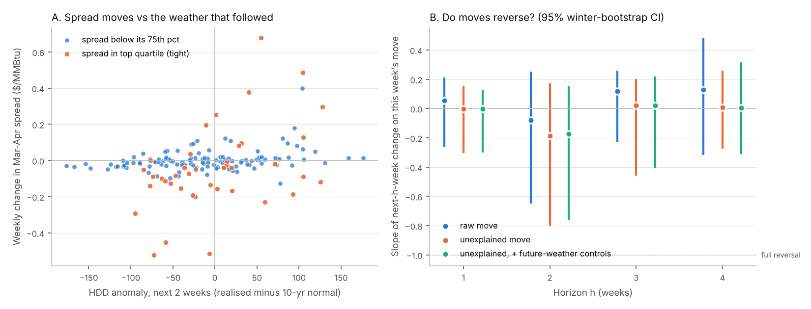
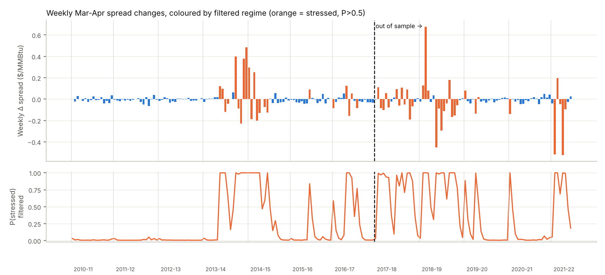
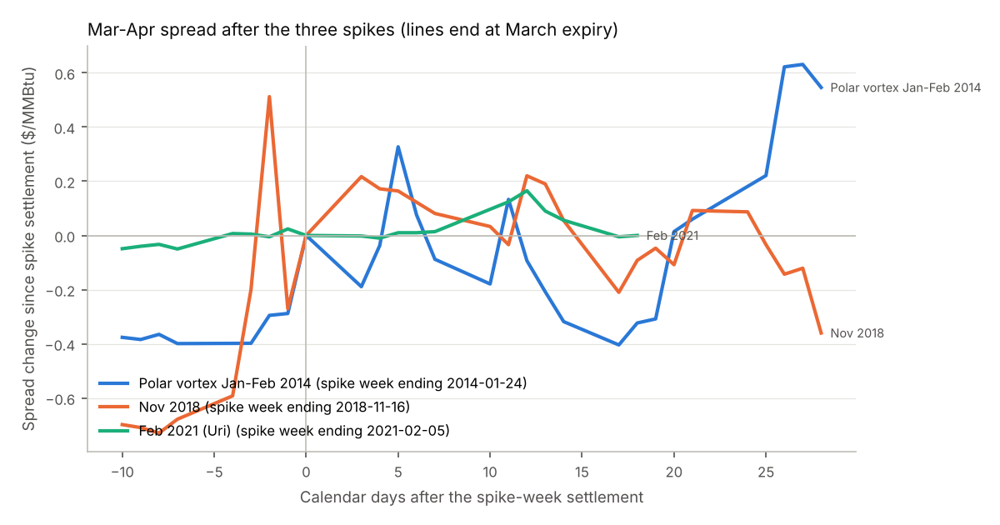

# regimes_weather: news, overreaction and regimes in the March−April spread (Q3 part 2, Q4)

*Agent `regimes_weather`. Data to 2021-12-31 only. Every input file is cut at load. Weekly winter sample: 190 Fridays, Nov 2010 to 24 Dec 2021. Winter 2021-22 covers Nov–Dec only.*

## 1. Plain-English findings
- **Storage surprises explain none of the weekly spread moves.** The report surprise against the 5-year average gives R² = 0.000 (95% CI 0.000–0.018). A weather-adjusted version also gives 0.000. **The weather of the next two weeks explains 8%** (ΔR² = 0.081, CI 0.026–0.143). Allowing that effect to grow with how tight the spread already is raises the explained share to 27% (CI 0.12–0.45). The market trades coming weather, not the storage number.
- **There is no average overreaction.** Neither the raw weekly move nor the part not explained by storage and weather reverses over 1–4 weeks. Every slope is near 0, and every CI spans 0 and excludes −1. The weather-explained part keeps going: slope +0.71 at 1 week (CI 0.13–1.54). Weather news gets priced gradually, not all at once.
- **Regimes are real and they hold out of sample.** A 2-state HMM fitted on 2010-17 separates a calm state (σ ≈ 2.7¢/week, typically lasting about 27 weeks) from a stressed state (σ ≈ 19¢/week, about 7 weeks). Run forward on 2017-21 with filtering only, average next-week |ΔS| was 11.5¢ in stressed weeks against 5.6¢ in calm weeks.
- **"Sell the spike" depends on the regime before the spike.** If the market was already stressed the week before, a jump partly reverses over 4 weeks: slope −0.49 (bootstrap CI −1.76 to −0.31), and −0.40 on 2017-21 alone (CI −1.75 to −0.23). If the market was calm, a jump tends to continue (+0.77, but the bootstrap CI −0.39 to 1.12 spans zero). Fading the first jump of a cold spell is the costly mistake.
- **The plain spike rule does not work in training.** Shorting after any weekly jump above X lost money at every X tried on 2010-17. Restricting it to already-stressed weeks made +$3,210 per spread on 2017-21, but on only 5 trades in 3 winters (CI $955–6,830), and just +$333 in training. Treat it as a hypothesis for the holdout, not a result.

## 2. Method
**Panel.** Each winter Friday F_t (Nov–Feb) uses the settlement on the first trading day on or after F_t, as in `model3_data`. S is the nearest winter's March minus April (H−J). ΔS_t = S(F_t) − S(F_{t−1}), and the forward change is fwd_h = S(F_{t+h}) − S(F_t). Expiry-day settlements are dropped, as are forward dates at or after the March expiry or after 2021-12-31.

**News between the two settlements:**
- *Storage surprise* `surp5`: the change for the week ending F_t − 7, reported on the Thursday in between, minus the average change for the same calendar week in prior years. `storage.csv` starts in 2010, so this uses 2–5 years and exists from Jan 2012, giving the primary sample of n = 163.
- *Robustness* `surpW`: the change minus a walk-forward fit of change on 1 + HDD + HDD² + trend, using earlier Nov–Mar weeks.
- *Weather news* wx2 = a₁ + a₂. These are the HDD anomalies of the weeks ending F_t+7 and F_t+14. Each anomaly is the HDD minus the mean of the same calendar week over the prior 10 years (at least 5 required). This is realised future weather, standing in for perfect forecasts. It is **not** tradable.

**Part A.** First ΔS = α + β·surp + γ·wx2 + ε, with HAC (2 lags) errors and a winter bootstrap of R² and ΔR² (2,000 resamples). Then the reversal test: fwd_h = a + b·x_t, where x is ΔS (raw), e (the residual of the model above) or the fitted part. A slope of b = −1 means the move fully reverses. Because e is built from future weather, a naive test could show spurious "reversal": the residual would then load against later weather-driven moves. Each test is therefore repeated controlling for a₁…a_{h+2}.

**Part B.** Gaussian HMMs with 2 and 3 states on ΔS, fitted on 2010-11 to 2016-17 with each winter as its own sequence and 30 random starts. Filtered probabilities are run forward with no smoothing, restarting each winter. A week is "stressed" if P > 0.5, using either the **pre-move** probability (data to t−1) or the post-move probability (data to t).

**Rule.** Short 1 spread (short March, long April) at the settlement when ΔS_t > X. Exit 4 weeks later, or at the last weekly settlement before March expiry. One position at a time. The cost is 4 ticks per leg round trip, i.e. $0.008/MMBtu or $80 per spread. X comes from {0.05, 0.10, 0.15, 0.20, 0.30} and is chosen on 2010-17 by mean P&L, with at least 3 trades.

## 3. Results

**Table 1 – What explains weekly ΔS** (`explain.csv`)

| Spec | n | R² (95% CI) | Weather coefficient |
|---|---|---|---|
| Storage surprise (5y) only | 163 | 0.000 (0.000–0.018) | – |
| + next-2-week HDD anomaly | 163 | 0.081 (0.034–0.145) | 0.054¢ per HDD, t = 3.3 |
| a₀, a₁, a₂ separately | 163 | 0.096 (0.053–0.167) | a₂ (the week entering the 2-week horizon) is strongest, t = 2.4 |
| Weather-adjusted surprise + wx2 | 169 | 0.068 (0.019–0.137) | t = 3.6 |
| Above × lagged spread level (convexity) | 163 | 0.274 (0.12–0.45) | wx2×S t = 4.4 |

In the convexity spec, a 2-week HDD anomaly of +100 moves the spread by about +6¢ when S = $0.10 and about +19¢ when S = $0.40. The storage coefficient is never significant (|t| ≤ 1.4).

**Table 2 – Do moves reverse?** (slope of fwd_h on x_t; winter-bootstrap 95% CI; `reversal.csv`; Fig. 1)

| x | h = 1 | h = 2 | h = 4 |
|---|---|---|---|
| Raw ΔS | +0.06 (−0.27, 0.21) | −0.08 (−0.65, 0.25) | +0.13 (−0.32, 0.48) |
| Unexplained e | −0.00 (−0.30, 0.15) | −0.19 (−0.80, 0.17) | +0.01 (−0.28, 0.26) |
| e, with future-weather controls | −0.00 (−0.30, 0.13) | −0.17 (−0.76, 0.15) | +0.00 (−0.31, 0.32) |
| e, out of sample (coefficients from 2011-17, tested on 2017-21) | +0.05 (−0.32, 0.20) | +0.05 (−0.41, 0.32) | +0.02 (−0.61, 0.21) |
| Weather-explained part | **+0.71 (0.13, 1.54)** | **+1.24 (0.20, 2.45)** | +1.63 (−0.51, 3.90) |

*Fig. 1 – Left: spread moves against the next 2 weeks' HDD anomaly; the response is much steeper when the spread is already wide. Right: reversal slopes with CIs.*

**Table 3 – HMM, fitted on 2010-17** (Fig. 2). BIC: 2-state −351.5, 3-state −332.5, so the 2-state model is preferred. The 3-state model only splits off a middle state (σ 8.4¢, lasting about 4 weeks).

| State | Mean ΔS | σ ΔS | P(stay) | Expected duration |
|---|---|---|---|---|
| Calm | −0.9¢ | 2.7¢ | 0.963 | 27 weeks |
| Stressed | +3.8¢ | 19.4¢ | 0.858 | 7 weeks |

Share of weeks stressed: 0% in 2010-13, 53% in 2013-14, 71% in both 2017-18 and 2018-19, 6% in 2020-21, 62% in Nov–Dec 2021. Out of sample, next-week |ΔS| averaged 11.5¢ in stressed weeks (median 7.8¢, n = 33) and 5.6¢ in calm weeks (median 1.9¢, n = 37).

*Fig. 2 – Weekly ΔS coloured by filtered regime, with P(stressed). Dashed line: start of the out-of-sample period.*

**Table 4 – Reversal by regime, h = 4** (`regime_reversal.csv`)

| Regime known at t−1 | Sample | n | Slope on ΔS | HAC t | Bootstrap CI | Leave-one-winter-out range |
|---|---|---|---|---|---|---|
| Stressed | 2010-21 | 41 | **−0.49** | −3.3 | (−1.76, −0.31) | −0.85 to −0.41 |
| Stressed | 2017-21 | 24 | **−0.40** | −2.5 | (−1.75, −0.23) | |
| Calm | 2010-21 | 101 | +0.77 | 4.8 | (−0.39, 1.12) | +0.58 to +0.96 |
| Calm | 2017-21 | 31 | +0.92 | 5.2 | (−0.20, 1.22) | |

The unexplained part e shows the same pattern: −0.57 (stressed) and +0.67 (calm). There is no regime effect at h = 1. Defining the regime **after** the move erases the effect, because a jump from a calm state flips the filter to stressed and mixes the onset of a cold spell with mid-episode spikes.

**Table 5 – Spike rule** (4-week hold, $ per spread, net of 4 ticks per leg)

| | Trades (winters) | Mean | 95% CI |
|---|---|---|---|
| Training, X = 0.05 (best of the grid; every X lost money) | 6 (4) | −$90 | (−1,696, 1,381) |
| Test 2017-21, X = 0.05 | 6 (4) | +$958 | (−1,370, 4,365) |
| Test, 1-week hold | 10 (4) | −$31 | (−1,484, 806) |
| Test, only when stressed at t−1 | 5 (3) | +$3,210 | (955, 6,830) |
| Training, only when stressed at t−1 | 4 (3) | +$333 | (−2,010, 3,930) |
| Test, only when calm at t−1 | 4 (3) | −$1,218 | (−7,780, 1,900) |

**Events** (Fig. 3; changes only, no price levels)
- **Polar vortex, 2014.** Weekly jumps: +39.9¢ (24 Jan; wx2 +104 HDD; P(stressed) before = 0.42), +37.8¢ (14 Feb) and +48.6¢ (21 Feb, 0.7 weeks before expiry, so it cannot be traded). After 24 Jan the spread dipped (−32¢ at 2 weeks) and then rose further (+55¢ at 4 weeks). Shorting it lost $5,540. Shorting 14 Feb lost $4,940 in its single week to expiry. Selling these spikes did not work.
- **November 2018.** 9 Nov: +12.9¢ from a calm state (wx2 +105 HDD). The move kept going (+68¢ after 1 week, +77¢ after 4), so a short lost $7,780. 16 Nov: +67.8¢ from an already-stressed state. The spread drifted +8¢ for 3 weeks and then fell 36¢ by week 4, so a short made $3,520. The intraweek peak on 14 November had already partly unwound by the Friday settlement.
- **February 2021 (Uri).** The March–April futures spread barely moved: the largest weekly move was +5.0¢ (5 Feb), even though wx2 was +119 HDD. The regime stayed calm (P ≤ 0.07) and the rule did not fire. The scarcity showed up in cash and the February contract, not in March−April.

*Fig. 3 – Daily spread change after the largest tradeable spike in each episode. Lines end at March expiry.*

## 4. What this tells us
**(a) The futures curve.** Weekly March−April moves are mostly about weather to come, and that sensitivity is convex in how tight the spread already is, as storage theory predicts. The market does not, on average, overshoot. If anything it under-prices forecastable weather and catches up over the following 1–2 weeks. The only sign of overshoot is mid-episode: once a stressed regime is under way, further jumps give back about half over a month. The first jump that starts a cold spell is information, not noise.

**(b) Storage expectations.** The weekly storage number adds nothing at the weekly horizon once you know the weather. The weather of the report week was already known, so the "surprise" against the 5-year average is mostly old news. For Q4, the gap between market and forecast that looks like overreaction is largely the market pricing 1–2-week forecasts that Models 1–2 do not use. Model 2 should take forecast weather for the next 2 weeks before its view is compared with the curve.

## 5. Caveats
- **Variants tried: 74 regressions or rules**, plus one discarded definition of the weather-adjusted surprise (the first fit used all weeks and was biased). By group: 7 explanation specs, 24 reversal regressions, 2 HMMs, 32 regime × reversal cells and 9 rule variants. The convexity spec and the regime-before-the-move split were thought of after seeing the first results. Treat Table 4 as the best of 32 cells.
- Weather news is realised weather, an upper bound on what forecasts could know. It is not available to a trader.
- `surp5` rests on only 2–4 prior years before 2015. Winter 2010-11 has no storage surprise.
- About 41 stressed-before weeks, 5–6 test trades and 12 winters: the CIs are wide, and the HAC and bootstrap intervals disagree for calm weeks.
- Friday sampling misses intraweek spikes, such as 14 Nov 2018.
- The HMM uses ΔS only. The spread-versus-tightness input was omitted because 5-year storage norms only exist from 2015.

## 6. Proposed holdout test (frozen)
- **Inputs:** weekly H−J spread for each winter Friday from 2022-01-07 to Feb 2026, built as in `data.py`. Use the frozen 2-state HMM in `data/processed/research_regimes_weather/hmm2_params_frozen.json` (not refitted), filtered forward and restarted each winter from `startprob`. Stressed_pre_t = 1 if P(stressed at t | ΔS up to t−1) > 0.5.
- **Target:** fwd_4 = S(F_{t+4}) − S(F_t), only where F_{t+4} falls before March expiry.
- **Statistic 1:** the OLS slope of fwd_4 on ΔS_t among weeks with stressed_pre = 1, with HAC (4 lags) errors.
- **Statistic 2:** the rule. Short 1 spread when ΔS_t > $0.05 and stressed_pre = 1. Hold 4 weeks, or exit at the last weekly settlement before expiry. One position at a time; 4 ticks per leg.
- **Pass:** the slope is below 0 with a one-sided HAC p < 0.05, **and** mean net P&L per trade is above 0. Also report the winter-bootstrap 95% CI and the trade count.
- **Secondary, not pass/fail:** the same slope in calm-before weeks (predicted to be ≥ 0).

## 7. How to rerun
`python -m src.research.regimes_weather.run` takes about 5 minutes on 2 CPUs, mostly the 2,000-draw winter bootstraps. It writes results to `data/processed/research_regimes_weather/` (`results.json` plus CSVs) and the three figures to `reports/agents/figures/regimes_weather_*.png`.
