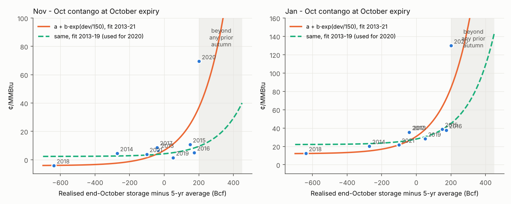
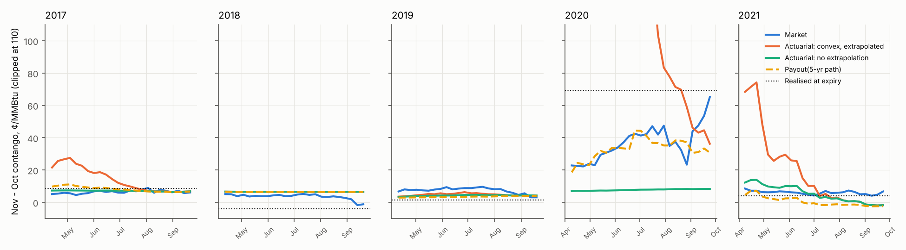
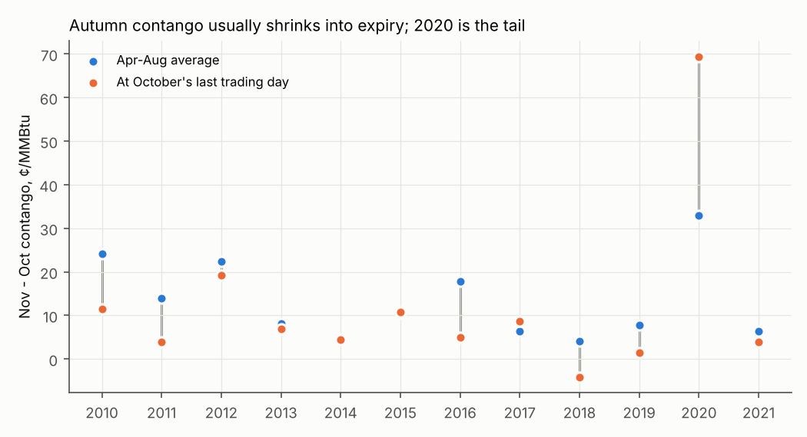

# Idea 2: the storage-space option (agent `storage_space_option`)

*Data: CME settles, EIA storage and weather dated before 2022-01-01 only. Model 2 summer origins are 2017-04-07 to 2021-10-22 (147 weeks), all ≤ 2021-12-31. Sign convention: contango C = far − near, so the brief's "V−X" is −C_XV, and "long V−X" means short contango.*

## 1. Plain-English findings
- **Autumn contango behaves like sold insurance, and the price data alone shows it.** From 2010 to 2021, Nov−Oct contango was higher in the Apr–Aug average than at October's expiry in **8 of 12 years**. The median fall was **2.8¢**. Contango fell from its June average to expiry in 11 of 12 years, though June was picked after looking. The 2020 tail cancels the gain, though. The mean drift is −1.5¢ (CI −7.1 to +6.6). Selling contango every summer day nets **−$11 per spread per year** at 4 ticks, against **+$334** in the other 11 years. 2020 alone cost **−$3,808**.
- **The payout is convex in fullness only because of one point.** At expiry, Nov−Oct contango rises with end-October storage against the 5-year average (Spearman 0.67, CI −0.09 to 0.98, n = 9). The convexity depends on 2020. Excluding 2020, 2016 was as full (+173 Bcf) and paid 5¢; 2020 (+201 Bcf) paid 69¢. **Jan−Oct is the cleaner storage-rent target**: Spearman 0.93 (CI 0.54 to 1.00), and the walk-forward payout beats the naive mean (MAE 19 vs 25¢).
- **The Model 2 "premium" is mostly an artefact of extrapolation.** Model 2's summer distribution has an upper tail that is physically impossible (p99 of 4.5–4.9 Tcf in 2017, 2020 and 2021). Pushed through a convex curve, that tail makes the actuarial value 25¢ to $3 and the premium strongly negative in spring. If the curve is not extrapolated beyond past autumns, the premium is about **0 ± 3¢** at the median, and the market sits on the payout of the 5-year path.
- **The premium does not robustly predict drift, and the conditional trade is not robust.** The pre-declared premium has a drift slope of 0.20 (year-block CI 0.006 to 0.42), but excluding 2020 it is **0.07 (CI −0.03 to 0.50, R² 0.05)**. The trade makes money at every threshold only because of 2020. Excluding 2020, it loses **$82 to $171 per spread** at every threshold. The non-extrapolating variants lose money including 2020.
- **Spring 2020 is the key episode.** In April the 5-year path pointed to an end-October level of 4.04–4.14 Tcf, which is +320 to +420 Bcf against normal. Contango was 22–24¢, about 3 times the 2013–19 norm, and roughly equal to payout(5-year path). Storage ended **200 Bcf below** that path, yet contango expired at **69¢**. Being long contango from 3 April gained about $4,660 per spread gross. Lower-48 fullness does not explain the 2020 rent.

## 2. Method
- **Targets.** For each autumn Y (2010–2021), I measure three contango spreads at the near contract's last trading day:
  - C_XV (Nov−Oct) and C_FV (Jan(Y+1)−Oct), at October's last trading day.
  - C_VU (Oct−Sep), at September's last trading day.
- **Fullness.** Two measures, both based on S_T, the last EIA week of October:
  - dev = S_T − the calendar-aligned average of the prior 5 years (at least 3 years, so 2013 onward).
  - head = maximum level before 1 January of Y − S_T. This is a walk-forward capacity proxy (3.84–4.05 Tcf), available from 2011.
- **Payout curve.** The pre-declared main form is C_exp = a + b·exp(dev/150 Bcf). It is linear in (a, b), so it is stable on 4–8 points, and convex toward fullness. For autumn Y, it is fitted only on autumns before Y. The alternatives were a linear fit, λ = 100 or 250, and an exp(−head/150) form.
- **Physical distribution.** I ran Model 2's `Simulator(n_resid_paths=200)` for every summer origin week, April to October of 2017–2021: 147 origins with 600–1,000 scenarios each. Percentiles 1–99 are cached in `data/processed/research_storage_space_option/model2_summer_percentiles_dev.csv`.
- **Actuarial value** at origin t is A_t = mean over the percentiles q of payout(q). There are four versions:
  - **raw:** Model 2 as simulated.
  - **robust (main):** percentiles shifted so that the median equals the 5-year path.
  - **point:** payout(5-year path).
  - Post-hoc diagnostics, added after seeing the results:
    - **clip:** fullness clipped to the range of past autumns.
    - **cap42:** simulated levels capped at 4.2 Tcf.
- **Premium, drift and trade.**
  - The market value is the contango at the first settle on or after t + 6 days, when storage for the week ending t becomes public.
  - Premium π = market − A_t. Drift D = C(expiry) − market.
  - Regression: D = α + β(−π). CIs come from a year-block bootstrap (4,000 draws) and leave-one-year-out.
  - Trade: if π > θ, short contango (long V−X); if π < −θ, long contango. Hold to October's last trade. P&L = position × D × 10,000 − $160, where $160 = 2 contracts × 2 sides × 4 ticks × $10.
  - Grid: θ ∈ {0, 2, 4, 6, 8, 10}¢, with either every week entered or only the first signal per summer.
- **Price-only, 2010–2021.** D_Y = C_XV(expiry) − the mean of C_XV over 1 April to 31 August (2010 starts on 4 June). I also report the drift for each entry month.

## 3. Results
**Model 2 summer bias** (147 origins): median − actual averages **−53 Bcf** (MAE 172), against **+44 Bcf** (MAE 154) for the 5-year path. That is far smaller than the winter bias of −250 Bcf, but it varies a lot by year: −377 in 2019 and +179 in 2020. The mean PIT is 0.56. Model 2's sd is 320 Bcf in April and 87 Bcf in September.

**Expiry spread vs realised fullness** (Spearman ρ, 95% bootstrap CI):

| Spread | vs dev (2013–21, n = 9) | vs head (2011–21, n = 11) | dev, excluding 2020 |
|---|---|---|---|
| Nov−Oct | 0.67 (−0.09, 0.98) | −0.72 (−0.97, −0.17) | 0.52 |
| Oct−Sep | 0.50 (−0.37, 1.00) | −0.52 (−0.91, 0.11) | 0.29 |
| Jan−Oct | **0.93 (0.54, 1.00)** | −0.87 (−1.00, −0.41) | 0.90 |

Walk-forward payout error (exp, λ = 150) against the mean of prior years, 2016–21:

| Spread | Payout MAE | Naive MAE |
|---|---|---|
| Nov−Oct | 14.5¢ | 15.5¢ |
| Oct−Sep | 4.2¢ | 4.4¢ |
| Jan−Oct | 19.2¢ | 25.3¢ |

Excluding 2020, the Nov−Oct figures are 5.5 vs 5.7¢ and the Jan−Oct figures 6.1 vs 10.4¢. The curve is shown in Fig. 1; it only steepens because of 2020.

**Premium by origin month** (Nov−Oct, median across 2017–21, ¢):

| Month | Market | Premium, robust (main) | Premium, clip | Premium, point | Drift to expiry |
|---|---|---|---|---|---|
| Apr | 7.2 | −20.7 | −1.5 | 0.1 | −3.3 |
| Jun | 6.8 | −7.5 | −0.4 | 0.2 | −1.4 |
| Aug | 6.5 | 0.3 | 2.1 | 0.6 | −2.6 |
| Sep | 5.6 | 0.7 | 1.3 | 1.7 | −0.8 |

The main premium "decays" from −21¢ to 0. That decay is Model 2's dispersion shrinking under a convex extrapolation, not a market premium. Without extrapolation the premium is never more than 2¢ from zero at the median (Fig. 2).

**Drift regression** (Nov−Oct, 122 weekly origins, 5 years). β = 1 would mean the premium is fully realised by expiry.

| Premium | β (95% CI) | R² | β, excluding 2020 (CI) |
|---|---|---|---|
| robust, main | 0.20 (0.006, 0.42) | 0.65 | 0.07 (−0.03, 0.50) |
| raw | 0.19 (−0.02, 0.56) | 0.49 | 0.01 (−0.03, 0.99) |
| point (5-year path) | 0.14 (−0.48, 1.05) | 0.00 | 0.11 (−0.46, 1.14) |
| clip | −0.86 (−0.96, 0.74) | 0.51 | 0.06 (−1.04, 1.66) |
| head, robust | 0.32 (0.11, 0.44) | 0.56 | 0.18 (0.03, 1.03) |

A benchmark regression of drift on −market alone gives β = −0.86 with R² 0.55, also driven by 2020. Every R² above 0.1 comes from 2020.

**Conditional trade** (Nov−Oct, 4 ticks per side; $ per spread; 95% CIs from a year bootstrap):

| Signal | θ | Trades / years | Mean | Mean of yearly means (CI) | Excluding 2020 |
|---|---|---|---|---|---|
| robust, main | 0 | 122 / 5 | +431 | +416 (−514, +1,673) | −171 |
| robust, main | 4¢ | 64 / 5 | +993 | +544 (−286, +1,680) | −82 |
| robust, main | 10¢ | 42 / 3 | +1,614 | +970 (−443, +3,222) | −156 |
| point | 4¢ | 56 / 5 | −29 | −135 (−588, +286) | +200 |
| clip | 4¢ | 49 / 4 | −1,707 | −881 (−2,601, +293) | +80 |
| cap 4.2 Tcf | 4¢ | 51 / 5 | −381 | −188 (−635, +259) | −106 |
| Always short contango | n/a | 122 / 5 | −564 | −545 (−2,011, +425) | +174 |

The pattern holds across thresholds, but it is not robust. Within the main signal, the sign of the result is set by 2020. Across signals, the sign is set by whether the payout is extrapolated. The first-signal-per-year versions show the same picture.

**Price-only, 2010–21** (Fig. 3). Drift is expiry minus the Apr–Aug average, in ¢. The last column nets out costs at 4 ticks.

| Spread | Years | Mean (CI) | Median | Years negative | Excl. 2020: mean (CI) | Short-contango $ per year |
|---|---|---|---|---|---|---|
| Nov−Oct | 12 | −1.5 (−7.1, 6.6) | −2.8 | 8 | −4.9 (−8.0, −2.0); Wilcoxon p 0.02 | −11 (+334 excl. 2020) |
| Oct−Sep | 12 | −1.1 (−2.9, 0.6) | −0.7 | 8 | −1.5 (−3.3, 0.2) | −51 |
| Jan−Oct | 12 | −0.8 (−8.2, 9.6) | −3.3 | 7 | −5.1 (−9.6, −0.8) | −84 (+347 excl. 2020) |

By entry month, the median Nov−Oct drift is −4 to −7¢ and is negative in 82–92% of years. The best month, June (11 of 12, binomial p 0.006), was picked after looking, so it is not significant once that choice is accounted for. Splitting by period: 2010–17 has mean −4.7¢ (CI −8.7, −0.9) with 5 of 8 years negative; 2018–21 has mean +4.9¢ with 3 of 4 negative.

**Power.** The yearly drift sd is 13¢ including 2020 and 5.4¢ excluding it. With 12 years, the smallest mean drift detectable at 80% power is about **10.5¢** (4.5¢ excluding 2020). The observed effect (median about −3¢) is below that. With the 5 Model 2 summers, nothing smaller than about 15¢ is detectable.

## 4. What this tells us
**(a) The futures curve.**
- Autumn contango is a storage-rent claim with an insurance-like payoff. It loses a few cents in most years and pays a large amount when the system is genuinely jammed (2020).
- In normal years the market prices it at about the payout of the 5-year path, so the premium is small and mostly undetectable.
- The convex tail is real (2020) but cannot be identified from 9–12 autumns.
- Jan−Oct, the full winter-over-October carry, tracks fullness more tightly than the front pair.

**(b) Storage expectations.**
- Summer-origin Model 2 is close to unbiased on average (−53 Bcf), but its upper tail exceeds physical capacity. Any option-style valuation therefore needs a capacity-aware simulator.
- In 2020 the market did not price the convex tail of the end-October distribution. The convex payout model did, wildly over-pricing it in level but getting the sign right. What actually happened was more than Lower-48 fullness predicts.

## 5. Caveats
- **Variants:** about 170 in total:
  - 15 payout forms
  - 5 actuarial families × 4 versions
  - 63 drift regressions
  - a trade grid of 6 signals × 6 thresholds × 2 entry modes, plus 1 benchmark
  - 3 price-only windows and 6 entry months
  
  The main specification (Nov−Oct, dev, exp λ = 150, robust centre) was declared before any result. clip and cap42 were added after seeing that results.
- **Effective sample:** 5 summers with Model 2 and 12 price-only autumns. Weekly observations within a summer are nearly the same observation.
- **Shared episode:** everything hinges on 2020. Excluding it is not legitimate for a premium claim, because it *is* the tail.
- **Expiry-day settles** of the October contract can be idiosyncratic.
- **Capacity proxy:** "head" uses the prior maximum since 2010 (3.84–4.05 Tcf), which understates true capacity.
- **Model 2 ignores capacity.** Weather analogs for 2017 begin with fewer years of history.

## 6. Proposed holdout test (frozen)
This is a price-only test of the insurance-like decay of Nov−Oct contango. It has not been touched by any v2 holdout test.
- **Inputs:** CME settles for October and November of each year Y ≥ 2022 with an expired October contract (2022–2026, so 5 autumns).
- **Statistic:** D_Y = C_XV at October's last trading day − mean C_XV over trading days from 1 April to 31 August of Y. Also the net P&L of shorting one Nov−Oct contango spread at each of those days' settles and holding to October's last trade, at 4 ticks per contract per side ($160 per spread), averaged within each year.
- **Pass:** D_Y < 0 in at least 4 of 5 years **and** the mean of the yearly net P&L > 0.
- **Fail:** fewer than 3 negative years, or mean net P&L < −$500 per spread.
- **Inconclusive:** anything else.
- **Also report:** whether any year had D_Y > +15¢ (a tail event).

## 7. How to rerun
From the repo root:

`PYTHONPATH=. python -m src.research.storage_space_option.simulate && PYTHONPATH=. python -m src.research.storage_space_option.analysis && PYTHONPATH=. python -m src.research.storage_space_option.figures`

- The simulation takes about 3 min on 1 CPU and is cached afterwards.
- The analysis takes 2 min alone, or about 7 min on the shared machine.
- The figures take a few seconds.
- Tables are written to `data/processed/research_storage_space_option/`.

## 8. New avenues
1. **Model 2 with a capacity constraint** (cap at about 4.1–4.3 Tcf, with excess pushed into price rather than storage). Expected value: it turns the extrapolated −21¢ "premium" into an interpretable option value. It is required before any convex valuation can be trusted.
2. **Jan−Oct as the storage-rent target.** It has the tightest fullness relation (ρ 0.93) and the only walk-forward payout with skill (MAE 6.1 vs 10.4¢ excluding 2020). Expected value: the best chance of a measurable autumn premium using Model 2.
3. **Regional (South Central / salt) fullness and LNG-export shocks** as payout covariates. 2020 paid 69¢ at only +201 Bcf in the Lower 48. Expected value: it would explain the one tail event that drives every result. It needs EIA regional storage, which is not available offline here.
4. **Autumn contango and winter March−April as one book of sold insurance.** Their tails fell in different years (2020 for autumn, 2014 for winter). Expected value: it tests whether combining the two premium harvests diversifies the blow-ups, with the 2010–21 price data already in hand.
